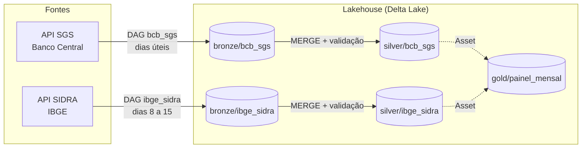

# Lakehouse de dados econômicos

[](https://github.com/R-it-a/lakehouse-dados-economicos/actions/workflows/ci.yml)

Pipeline de dados que coleta indicadores econômicos públicos do **Banco Central** e do **IBGE**, organiza tudo em um lakehouse com camadas **bronze, silver e gold** e entrega um painel mensal pronto para análise.

Feito com **Apache Airflow 3**, **Polars** e **Delta Lake**, com testes automatizados, checagens de qualidade e CI no GitHub Actions.

## Arquitetura



| Camada | O que guarda | Como é escrita |
|---|---|---|
| **Bronze** | Resposta das APIs como chegou (texto), com lote e horário da carga | Append, particionada por série |
| **Silver** | Dados tipados, sem duplicatas, uma linha por série e data | MERGE pelas chaves de negócio |
| **Gold** | Painel mensal com indicadores derivados | Reescrita completa a cada atualização |

## Dados

**Banco Central (SGS)**

| Código | Série | Frequência |
|---|---|---|
| 432 | Meta da taxa Selic | Diária |
| 433 | IPCA, variação mensal | Mensal |
| 189 | IGP-M, variação mensal | Mensal |
| 1 | Dólar americano (venda) | Diária |

**IBGE (SIDRA)**: tabela 1737, número-índice do IPCA.

**Painel mensal (gold)**: Selic no fim do mês, IPCA mensal e acumulado em 12 meses, IGP-M, dólar médio e de fim de mês, **juro real ex-post** (Selic deflacionada pelo IPCA de 12 meses) e o número-índice do IPCA.

## Decisões de engenharia

- **Carga incremental com janela de revisão.** A primeira execução busca o histórico desde 2000. As seguintes buscam só os últimos 90 dias, para capturar valores que a fonte corrigiu, sem baixar tudo de novo.
- **Idempotência.** A silver usa MERGE pelas chaves (`serie_codigo`, `data`). Rodar o mesmo dia duas vezes não duplica nenhuma linha.
- **Falhar em vez de errar em silêncio.** Coleta vazia, chave duplicada, valor fora da faixa esperada ou série sem atualização há mais tempo que o normal interrompem a execução com uma mensagem clara.
- **Transformações puras.** As regras de negócio (`transforms.py`) não acessam rede, disco nem relógio. Por isso são simples de testar.
- **Lógica separada do orquestrador.** As DAGs só chamam funções do pacote `lakehouse`. O mesmo pipeline roda pelo Airflow ou pela linha de comando.
- **Agendamento orientado a dados.** A DAG da gold não tem horário: o Airflow a dispara quando uma das tabelas silver é atualizada (Assets do Airflow 3).
- **Limites da API respeitados.** O SGS aceita no máximo 10 anos por consulta em séries diárias, então o cliente divide o período em janelas e tenta de novo, com espera exponencial, em erros temporários.

## Como rodar

### Com Airflow (Docker)

```bash
make subir        # ou: docker compose up --build -d
```

Abra http://localhost:8080 e ative as DAGs `bcb_sgs` e `ibge_sidra`. A `gold_painel` roda sozinha quando as duas atualizam a silver. Os dados ficam em `data/lake/`.

### Sem Airflow

```bash
make instalar     # ou: pip install -e ".[dev]"
make pipeline     # roda bronze -> silver -> gold e mostra os últimos 12 meses
```

### Consultando o resultado

```python
import polars as pl

painel = pl.read_delta("data/lake/gold/painel_mensal")
print(painel.tail(12))
```

## Testes

```bash
make testes
```

Os testes cobrem os clientes HTTP (com respostas simuladas), as transformações, as checagens de qualidade, a idempotência do MERGE e o fluxo completo de bronze a gold. No CI, um job separado instala o Airflow e confirma que todas as DAGs carregam sem erros.

## Estrutura

```
dags/
  assets.py          Assets compartilhados entre as DAGs
  bcb_sgs.py         coleta do Banco Central (uma task por série)
  ibge_sidra.py      coleta do IBGE
  gold_painel.py     painel mensal, disparado pelos Assets
src/lakehouse/
  clients.py         clientes HTTP com novas tentativas e janelas de consulta
  transforms.py      regras de bronze, silver e gold (funções puras)
  quality.py         checagens de qualidade
  storage.py         leitura e escrita Delta (append, MERGE, overwrite)
  pipelines.py       etapas do pipeline usadas pelas DAGs e pela CLI
  cli.py             execução completa sem Airflow
tests/               testes unitários e de ponta a ponta
```

## Próximos passos

- Incluir mais séries (CDI, IBC-Br, expectativas do Focus)
- Publicar o painel em um dashboard
- Mover o armazenamento para nuvem (Azure Data Lake ou S3)

## Autora

Rita Farias · [LinkedIn](https://www.linkedin.com/in/rita-farias-b24a33232/)
